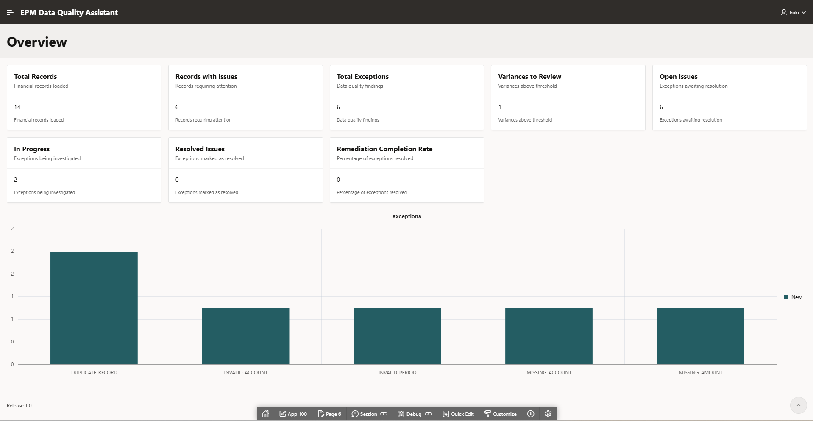
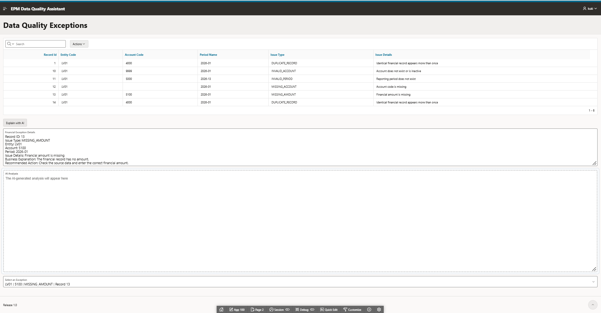
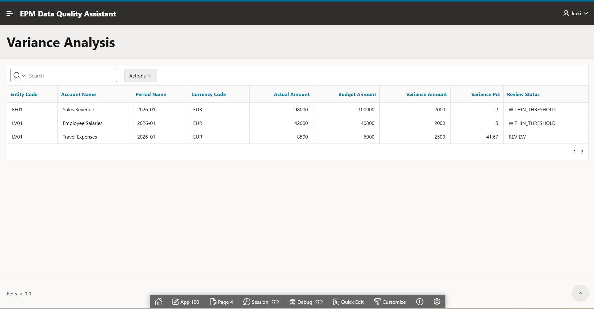
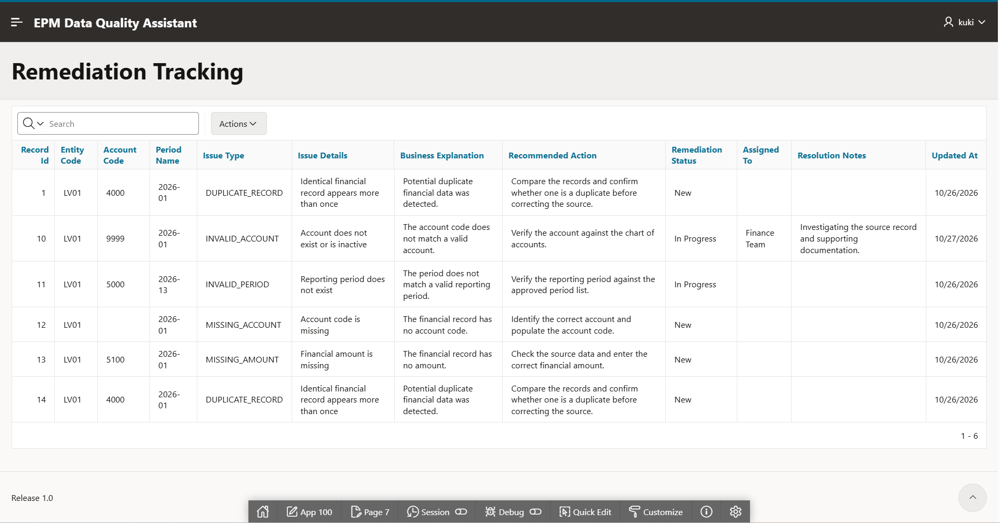
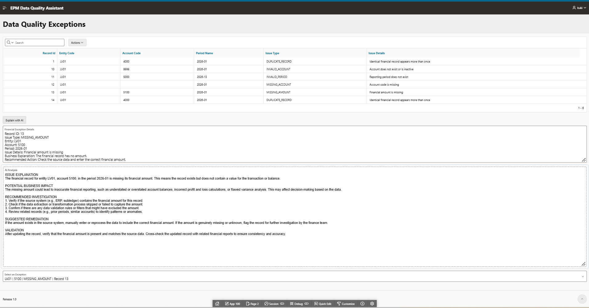

# EPM Data Quality Assistant

**An Oracle APEX application for financial data quality, variance analysis, remediation tracking, and AI-assisted investigation.**

The EPM Data Quality Assistant demonstrates how SQL-based validation rules and generative AI can help finance teams identify data issues, investigate their potential business impact, and manage remediation through a single application.

Built with Oracle Autonomous AI Database, Oracle APEX, Oracle SQL, and OCI Generative AI.

---

## Application Overview

The application combines rule-based data quality checks, financial variance analysis, remediation tracking, and AI-generated explanations in one workflow.

### Dashboard

The Overview dashboard provides a summary of financial data quality, outstanding exceptions, remediation progress, and exception categories.



### Data Quality Exceptions

The application identifies common financial data problems, including missing account codes, missing amounts, invalid accounts, invalid periods, and duplicate records. Each exception includes a business explanation and a recommended action.



### Variance Analysis

The variance report compares actual financial amounts against budget values. It calculates absolute and percentage variances and flags results requiring further review.



### Remediation Tracking

Users can manage the remediation lifecycle by updating issue status, assigning responsibility, recording resolution notes, and tracking the latest update.



### AI-Assisted Investigation

The AI feature uses OCI Generative AI to analyze a selected financial exception. The application supplies the exception details and relevant business context to the model, which generates an explanation, potential business impact, investigation steps, suggested remediation, and validation guidance.



---

## Business Problem

Financial data used for reporting and analysis can contain incomplete records, invalid references, duplicate entries, and unexpected differences between actual and budget amounts.

These problems can lead to unreliable reports, additional manual investigation, and delays in the financial close process.

The application demonstrates a structured approach to this problem:

1. Detect data quality exceptions using SQL rules.
2. Calculate and identify financial variances requiring review.
3. Explain why an exception matters from a business perspective.
4. Generate investigation and remediation suggestions using generative AI.
5. Track remediation status and responsibility.
6. Validate changes through reports and database queries.

The objective is to make financial data issues easier to understand, investigate, and manage.

---

## Key Features

| Feature | Implementation |
|---|---|
| Data quality validation | Oracle SQL views identify common financial data exceptions. |
| Financial variance analysis | SQL calculations compare actual amounts with budgets. |
| Business explanations | Exceptions include explanatory text and recommended actions. |
| AI-assisted investigation | OCI Generative AI produces structured analysis of selected exceptions. |
| Remediation management | Editable Oracle APEX Interactive Grid for status, ownership, and resolution notes. |
| Progress monitoring | Dashboard metrics summarize exceptions and remediation progress. |
| Data persistence | Remediation updates are stored in the database and reflected in reports. |
| Timestamp management | Database trigger updates the remediation timestamp on insert or update. |

---

## Technology Stack

- **Oracle Autonomous AI Database** — relational data storage and SQL processing.
- **Oracle SQL** — data quality rules, joins, aggregations, variance calculations, and reporting views.
- **Oracle APEX** — dashboard, interactive reports, editable grid, page items, and dynamic actions.
- **OCI Generative AI** — AI-generated explanations and investigation recommendations.
- **PL/SQL** — database trigger logic for remediation timestamps.
- **GitHub** — source control, documentation, SQL scripts, and functional test queries.

---

## Architecture

The application separates deterministic database logic from AI-generated analysis.

```text
Financial Data
      |
      v
Oracle Database
      |
      +--> Data Quality Views
      |
      +--> Variance Analysis View
      |
      +--> Remediation Views
      |
      v
Oracle APEX Application
      |
      +--> Overview Dashboard
      |
      +--> Exceptions Report
      |
      +--> Variance Analysis
      |
      +--> Remediation Tracking
      |
      +--> AI-Assisted Investigation
                  |
                  v
          OCI Generative AI
                  |
                  v
       Structured AI Explanation
```

**Important design principle:** SQL determines which records meet the defined validation rules and calculates financial variances. Generative AI provides contextual explanations and suggested next steps; it does not independently establish the validity of financial data.

See [`docs/architecture.md`](docs/architecture.md) for additional architecture details.

---

## Data Quality Rules

The demonstration dataset includes intentionally introduced data quality issues.

| Issue type | Purpose |
|---|---|
| `MISSING_ACCOUNT` | Detect records without a required account code. |
| `MISSING_AMOUNT` | Detect records with a missing financial amount. |
| `INVALID_ACCOUNT` | Identify account references that do not match the account master data. |
| `INVALID_PERIOD` | Identify period references that do not match the period master data. |
| `DUPLICATE_RECORD` | Identify records that violate the defined duplicate-detection rule. |

These rules are implemented in the database layer so the results can be queried and reused by the application.

The demonstration uses synthetic data and simplified business rules. Production implementations would require agreed data definitions, materiality thresholds, validation policies, and exception-handling procedures.

---

## AI Integration

The AI-assisted workflow is designed to support, rather than replace, financial and data-quality analysis.

1. A user selects a financial exception.
2. Oracle APEX retrieves the corresponding exception details.
3. The details populate the AI request field.
4. A dynamic action invokes the configured OCI Generative AI service.
5. The model returns a structured response containing:
   - Issue explanation
   - Potential business impact
   - Recommended investigation
   - Suggested remediation
   - Validation steps
6. The user reviews the response and determines the appropriate next action.

The prompt instructs the model to distinguish confirmed facts from assumptions, avoid inventing missing financial values, and avoid claiming that database records have been changed.

**Human validation remains necessary.** AI-generated recommendations are suggestions, not approved accounting adjustments or automated data corrections.

See [`docs/ai-integration.md`](docs/ai-integration.md) for more information.

---

## Database Objects

The database layer uses the following core objects:

| Object | Purpose |
|---|---|
| `EPM_ACCOUNTS` | Account master data. |
| `EPM_PERIODS` | Financial period reference data. |
| `EPM_FINANCIAL_DATA` | Financial records containing actual and budget values. |
| `EPM_DATA_QUALITY_V` | Data quality exception detection. |
| `EPM_VARIANCE_V` | Actual-versus-budget variance calculations. |
| `EPM_REMEDIATION_V` | Exception explanations and recommended actions. |
| `EPM_REMEDIATION_TRACKING` | Persistent remediation status, ownership, and notes. |
| `EPM_REMEDIATION_STATUS_V` | Exception details combined with remediation tracking information. |
| `EPM_REMED_TRACK_BIU` | Trigger that maintains the remediation update timestamp. |

The application queries database objects using explicit schema references where required.

---

## Repository Structure

```text
epm-data-quality-assistant/
├── README.md
├── docs/
│   ├── README.md
│   ├── architecture.md
│   └── ai-integration.md
├── screenshots/
│   ├── README.md
│   ├── 01-overview.png
│   ├── 02-data-quality-exceptions.png
│   ├── 03-variance-analysis.png
│   ├── 04-remediation-tracking.png
│   └── 05-ai-analysis.png
├── sql/
│   ├── README.md
│   ├── 01_remediation_tracking.sql
│   ├── 02_remediation_status_view.sql
│   ├── 03_remediation_timestamp_trigger.sql
│   └── 04_diagnostic_queries.sql
└── tests/
    ├── README.md
    └── functional_validation.sql
```

The tree above describes the intended project layout. The SQL folder contains selected database scripts and diagnostics; it is not necessarily a complete, standalone database installation package.

---

## Testing and Validation

The application was functionally tested using the seeded demonstration dataset.

| Test area | Expected result |
|---|---|
| Data quality exceptions | Six exception rows displayed. |
| Variance analysis | Three financial comparisons displayed. |
| Variance review | Travel Expenses flagged for review at 41.67% above budget. |
| Remediation tracking | Six exception rows displayed with persistent tracking fields. |
| Status updates | Changes to remediation status and notes persist in the database. |
| AI analysis | Selected exception details generate a structured five-section response. |
| Overview dashboard | Summary metrics and exception-category chart display correctly. |

Diagnostic and validation SQL is provided in the [`tests/`](tests/) and [`sql/`](sql/) directories.

These results apply to the current demonstration dataset and configured environment; they are not a claim of production-scale performance or comprehensive automated test coverage.

---

## Setup and Reproducibility

The application was developed in Oracle Autonomous AI Database and Oracle APEX, with an OCI Generative AI service configured for AI-assisted analysis.

The repository includes selected SQL scripts, diagnostics, documentation, and functional validation queries.

To recreate the application, additional environment-specific configuration and the complete definitions of the original financial tables and validation views may be required. OCI credentials, private keys, and other secrets must be configured securely in the target environment rather than copied from the development environment.

Refer to:

- [`sql/README.md`](sql/README.md)
- [`tests/README.md`](tests/README.md)
- [`docs/architecture.md`](docs/architecture.md)
- [`docs/ai-integration.md`](docs/ai-integration.md)

---

## Security and Limitations

- The demonstration uses synthetic financial data.
- AI output may be incomplete or incorrect and must be reviewed by a qualified user.
- AI suggestions do not directly modify financial records.
- Production use would require appropriate authorization, audit logging, data protection, monitoring, and error handling.
- OCI credentials and private keys must never be committed to the repository.
- The included SQL scripts represent selected project components; additional database objects may be necessary to reproduce the complete environment.

---

## Skills Demonstrated

**Oracle SQL and PL/SQL**
- Relational data modelling and joins
- Conditional validation rules
- Aggregations and exception reporting
- Financial variance calculations
- Database views and triggers
- Diagnostic and functional validation queries

**Oracle APEX**
- Interactive Reports and Interactive Grid
- Dashboard metrics and charting
- Dynamic Actions and page-item state
- Editable data with database persistence

**Generative AI**
- OCI Generative AI service integration
- Prompt design for structured business analysis
- Context-driven exception investigation
- Human-in-the-loop validation and responsible AI boundaries

**Business analysis**
- Translating financial data issues into actionable investigation steps
- Separating deterministic calculations from AI-generated interpretation
- Tracking remediation ownership and progress

---

## Project Status

**Functional portfolio prototype.**

The core workflow is implemented and functionally tested against the demonstration dataset. Further work could include automated regression testing, broader validation rules, role-based access controls, and a more complete database deployment package.

---

## Author

Kokab Shabanipour Developed as a portfolio project demonstrating practical use of Oracle SQL, PL/SQL, Oracle APEX, and OCI Generative AI for financial data quality and remediation workflows.
